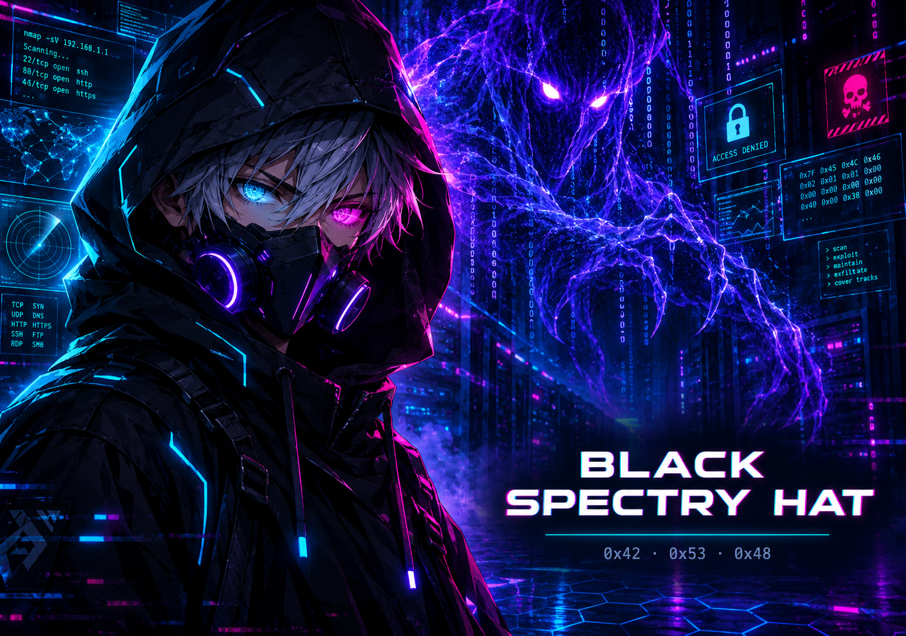

<div align="center">



</div>
---
`> whoami`
Olá, sou Black Spectry Hat. Exploro o universo da programação e cibersegurança, com foco em aprender, construir ferramentas e compreender como sistemas funcionam — e como protegê-los.
Interesses: Ethical Hacking, segurança defensiva, análise de redes, desenvolvimento back-end e evolução rumo ao Full Stack. Testes de segurança, sempre em ambientes próprios ou com autorização.
```bash
$ cat identity.txt
alias: BLACK SPECTRY HAT
focus: Cybersecurity + Software Development
mission: Learn. Build. Analyze. Secure.
status: Always learning...
```
`> areas --focus`
Cybersecurity: fundamentos de redes, Linux, análise de tráfego e segurança defensiva.
Ethical Hacking: laboratórios controlados, identificação de vulnerabilidades e estudo de técnicas de ataque para fortalecer defesas.
Development: construção de aplicações, APIs e soluções web.
Next level: aprofundar conhecimentos em back-end, Full Stack e operações de segurança (SOC).
`> ls ./tech-stack`
Programação e Web
       
Ferramentas e estudos em segurança
    
`> github --stats`
<div align="center">


</div>
> As linguagens acima refletem os repositórios públicos, não o nível de domínio técnico.
`> connect --secure`


<div align="center">
---
`[ BLACK SPECTRY HAT // END OF TRANSMISSION ]`  
Knowledge is power. Security is responsibility.
</div>
