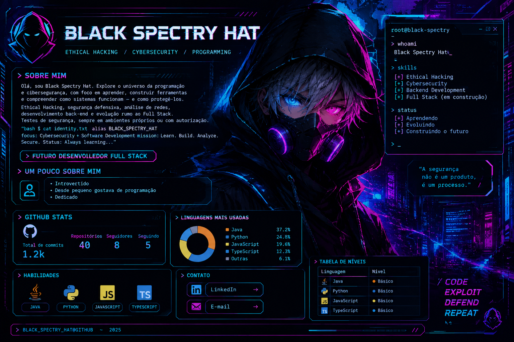

<div align="center">


# `BLACK SPECTRY HAT`

**`ETHICAL HACKING`** &nbsp; // &nbsp; **`CYBERSECURITY`** &nbsp; // &nbsp; **`PROGRAMMING`**


</div>

---

### `> whoami`

```bash
$ cat identity.txt
alias: BLACK SPECTRY HAT
focus: Cybersecurity + Software Development
mission: Learn. Build. Analyze. Secure.
status: Always learning...
```

Olá, sou **Black Spectry Hat**. Exploro programação e cibersegurança para compreender como sistemas funcionam, construir soluções e aprender a protegê-los. Tenho interesse em **segurança defensiva, análise de redes, Ethical Hacking e desenvolvimento back-end**, com evolução rumo ao Full Stack.

> Testes de segurança apenas em laboratórios próprios ou ambientes com autorização.

### `> cat /etc/interests`

| `CYBERSECURITY` | `DEVELOPMENT` |
|:---|:---|
| Segurança defensiva e fundamentos de redes | Back-end e APIs |
| Linux e análise de tráfego | PHP, Java e Python |
| Laboratórios de Ethical Hacking | JavaScript e TypeScript |
| Estudo de vulnerabilidades e OWASP | Bancos de dados e aplicações web |

### `> ls ./tech-stack`

<div align="center">


</div>

### `> github --stats`

<div align="center">


</div>

### `> ./current-mission.sh`

```text
[+] Aprimorar desenvolvimento back-end
[+] Estudar redes, Linux e segurança defensiva
[+] Praticar Ethical Hacking em laboratórios autorizados
[+] Evoluir em Full Stack e segurança de aplicações
```

### `> contact --open`

<div align="center">

[](https://github.com/Victor-Miguel-Rodrigues)


<sub>Substitua os badges de LinkedIn e e-mail pelos seus links reais antes de publicar.</sub>

---

**`CODE / EXPLOIT / DEFEND / REPEAT`**

`0x42 · 0x53 · 0x48`

</div>

<div>



</div>